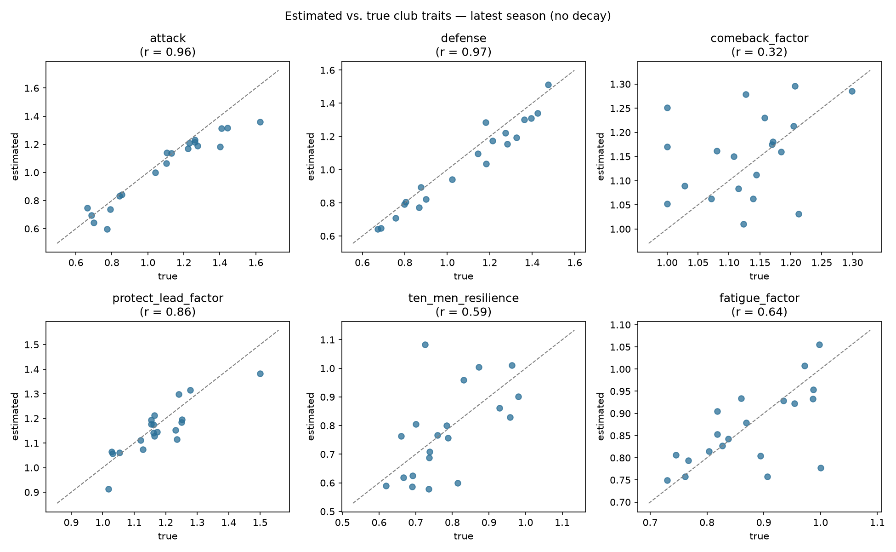

# Sliding Doors — Counterfactual Match Intelligence

Built for the Microsoft x Premier League "Inside the Game" hackathon.

"Sliding Doors" re-runs a football match from any moment, hundreds of
times, with one thing changed — a penalty scored, a red card not given —
and measures how much that moment shifted the win probability. An AI
agent answers fans' "what if" questions about the match in plain language.

See [SPEC.md](SPEC.md) for the full MVP checklist and rules.

## Project structure

```
src/
  league.py             # fictional clubs + their hidden "true" traits (and how traits drift between seasons)
  squad.py               # ~14-player squads per club (shot/card shares, hidden finishing skill)
  match_engine.py         # simulates a single match minute by minute, via shots and xG
  season_generator.py     # schedules and simulates multiple seasons
  trait_estimation.py     # recovers each club's hidden traits from the generated data (Poisson regression)
scripts/
  generate_season.py      # entry point: builds a league + squads, generates seasons, saves + summarizes
  estimate_traits.py       # estimates current traits, sweeps recency half-lives, validates, plots
data/
  *.csv                   # generated season data (matches, shots, goals, red cards, players, true/estimated traits)
assets/
  trait_validation.png     # estimated vs. true traits scatter (see below)
```

## Setup

```bash
python3 -m venv .venv
source .venv/bin/activate
pip install -r requirements.txt
```

## Generate seasons

```bash
python scripts/generate_season.py
```

Creates a fictional 20-club league (each with hidden traits and a squad
of ~14 players), simulates 5 seasons of a double round-robin, and writes
matches/shots/goals/red_cards/players/true_traits to `data/`.

## Estimate traits

```bash
python scripts/estimate_traits.py
```

Estimates each club's current traits from the shot-level data using a
weighted Poisson regression, tries several recency half-lives, and
validates the estimates against the known true traits for the latest
season. Saves `data/estimated_traits.csv` and the chart below.

### Estimated vs. true traits (latest season, best half-life = no decay)



Attack and defense are recovered almost exactly (r = 0.96–0.97) — there's
a shot on goal almost every few minutes, so there's a lot of signal.
`protect_lead_factor` (r = 0.86) and `fatigue_factor` (r = 0.64) are
decent. `comeback_factor` (r = 0.32) and `ten_men_resilience` (r = 0.59)
are the hardest: comeback_factor shares one degree of freedom with
protect_lead_factor (trailing and leading are literally the same event
seen from each side, so the model can only pin down their *difference*
cleanly, not each one's absolute level), and ten_men_resilience is
estimated from red cards, which are rare (~12 per club across 5 seasons).

"No decay" (pooling all 5 seasons equally) won because traits only drift
slowly season to season — with a small, gradual random walk and just an
occasional bigger jump, more pooled data reduces noise more than recency
weighting helps. If clubs changed faster, a shorter half-life would win
instead.
