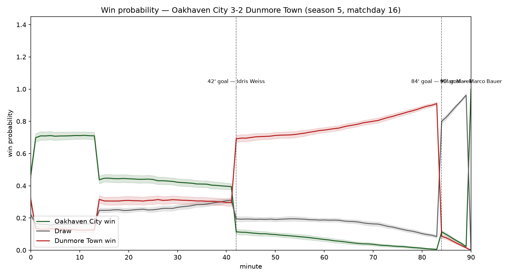
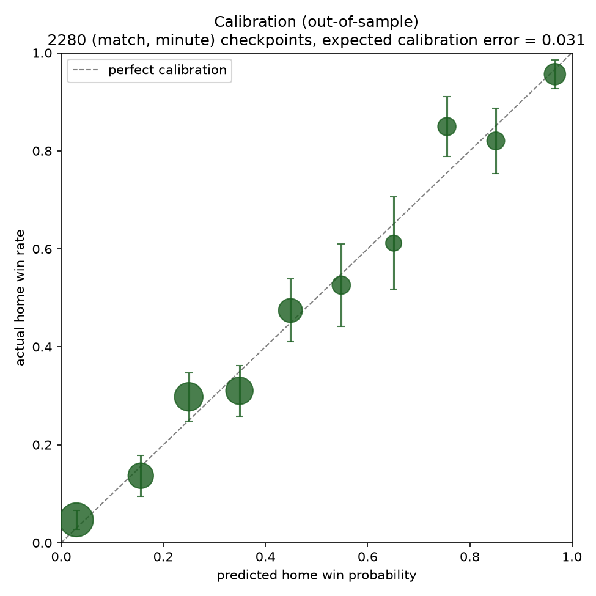
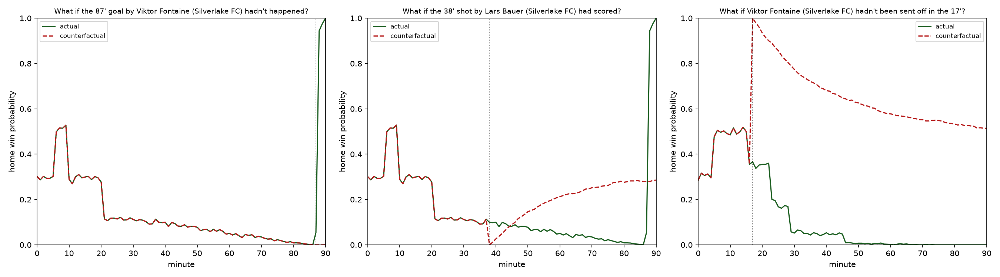

# Sliding Doors — Counterfactual Match Intelligence

Built for the Microsoft x Premier League "Inside the Game" hackathon.

"Sliding Doors" re-runs a football match from any moment, hundreds of
times, with one thing changed — a penalty scored, a red card not given —
and measures how much that moment shifted the win probability. An AI
agent answers fans' "what if" questions about the match in plain language.

See [SPEC.md](SPEC.md) for the full MVP checklist and rules.

## Project structure

```
src/
  league.py             # fictional clubs + their hidden "true" traits (and how traits drift between seasons)
  squad.py               # ~14-player squads per club (shot/card shares, hidden finishing skill)
  match_engine.py         # simulates a single match minute by minute, via shots, xG, day form, and pressure spells
  season_generator.py     # schedules and simulates multiple seasons
  trait_estimation.py     # recovers each club's hidden traits from the generated data (Poisson regression)
  win_probability.py      # vectorized Monte Carlo re-simulation -> win/draw/loss probability from any match state
  counterfactual.py       # re-simulates a match with one real event changed (shot/goal/red card)
  storylines.py           # turns between-season trait jumps into plain-language text (no model logic)
  agent_tools.py           # tools wrapping the engine for the AI agent (list events, win prob, counterfactual, club profile)
  agent.py                 # the AI agent itself: Analyst (tool use) + Narrator (writing style) -- see "AI agent" below
scripts/
  generate_season.py      # entry point: builds a league + squads, generates seasons, saves + summarizes
  estimate_traits.py       # estimates current traits, sweeps recency half-lives, validates, plots; also estimates
                            # the day-form effect size and builds the power ranking (see sections below)
  win_probability.py       # picks the most dramatic match, plots its win-probability curve + turning points
  calibration.py            # checks predicted win probabilities (in- and out-of-sample), and the day-form ablation
  counterfactual_demo.py    # demos the counterfactual engine on 3 "what if" scenarios
  precompute_featured_matches.py  # fits the model once, precomputes curves for ~11 matches so the app loads instantly
data/
  *.csv                   # generated season data (matches, shots, goals, red cards, players, true/estimated traits)
  trait_jumps.csv          # which club/season/trait had a "big jump" between seasons, and by how much
  power_ranking.csv         # the model's power ranking (see "Power ranking" below)
  featured_curves.csv, featured_turning_points.csv, featured_matches.json  # precomputed for instant loading
  model_params.csv, model_cov.csv, model_team_draws.csv  # the fitted trait model, saved so the app never refits it
  model_league_constants.csv  # shot-rate/composition/day-form constants estimated from data (see "removing data leakage" below)
assets/
  trait_validation.png     # estimated vs. true traits scatter (see below)
  win_probability.png      # win probability chart for the most dramatic match (see below)
  calibration.png           # predicted vs. actual win rates, out-of-sample (see below)
  counterfactual_demo.png   # actual vs. counterfactual curves for 3 "what if" scenarios (see below)
app.py                    # interactive Streamlit UI (see below)
tests/                    # pytest suite: data integrity, model logic, consistency, home advantage/leakage, day form, agent
.env / .env.example       # Azure OpenAI credentials for the AI agent (never committed -- see "AI agent" below)
.streamlit/config.toml    # dark sports-product theme
.claude/skills/developing-with-streamlit/  # official Streamlit agent skill (vendored, see Setup)
```

## Setup

```bash
python3 -m venv .venv
source .venv/bin/activate
pip install -r requirements.txt
cp .env.example .env   # then fill in AZURE_OPENAI_* (see "AI agent" below) -- optional, only needed for the agent
```

The repo vendors the official [Streamlit agent skill](https://github.com/streamlit/agent-skills)
under `.claude/skills/developing-with-streamlit/` — Claude Code picks it up
automatically for any Streamlit work in this project (styling, caching,
layout, etc.).

## Generate seasons

```bash
python scripts/generate_season.py
```

Creates a fictional 20-club league (each with hidden traits and a squad
of ~14 players), simulates 5 seasons of a double round-robin, and writes
matches/shots/goals/red_cards/players/true_traits to `data/`.

On top of each club's fixed season-to-season traits, every match also
gets two things no club trait captures, both real (not decorative) in
that they actually move the shot rate and chance quality, and are picked
up by the model below: a hidden **day form** (`home_day_form`/
`away_day_form` columns in `matches.csv`, Gamma-distributed, mean 1 —
some days a team just creates more/better chances than their usual
level, unknown at kickoff and never revealed to the estimation side),
and short in-match **pressure spells** (a team randomly enters an "on
top" spell for a few minutes at a time, boosting its own shot rate and
chance quality, then fades back to normal). Both are split evenly across
the shot-rate and shot-quality channels (as the square root of the
combined effect), which matters for how the model reads them back out
— see "Day form and momentum" below.

## Estimate traits

```bash
python scripts/estimate_traits.py
```

Estimates each club's current traits from the shot-level data using a
weighted Poisson regression, tries several recency half-lives, and
validates the estimates against the known true traits for the latest
season. Saves `data/estimated_traits.csv` and the chart below.

### Estimated vs. true traits (latest season, best half-life = no decay)


Attack and defense are recovered almost exactly (r = 0.95–0.98) — there's
a shot on goal almost every few minutes, so there's a lot of signal.
`fatigue_factor` (r = 0.66) is decent. `comeback_factor` (r = 0.53),
`protect_lead_factor` (r = 0.64), and `ten_men_resilience` (r = 0.45) are
the hardest.

`comeback_factor` and `protect_lead_factor` share one degree of freedom
(trailing and leading are literally the same event seen from each side),
but that only shifts their *absolute level* by one shared constant — it's
gauge-invariant and verified not to affect correlation at all. The real
reasons these three are harder: their true values vary less across clubs
than attack/defense do, they're each estimated from a narrower slice of
minutes (trailing, leading, or down-a-man minutes, not every minute of
the match) -- and, since adding day form and pressure spells (see below),
there's now a second source of real match-to-match noise sitting on top
of attack/defense that these state-dependent traits are more exposed to
than attack/defense are (they're identified from fewer minutes, so the
same amount of extra noise moves them more). `protect_lead_factor` in
particular dropped the most (was r = 0.86) for exactly this reason.
`ten_men_resilience` is additionally estimated from red cards, which are
rare (~11 per club across 5 seasons).

Shrinkage (pulling each club's estimate toward the league average,
weighted by how much data backs it) now helps all four of the noisier
traits (it only helped two before day form/pressure added their extra
noise) — `comeback_factor` MAE 0.076 → 0.065, `protect_lead_factor`
0.102 → 0.087, `ten_men_resilience` 0.100 → 0.072, `fatigue_factor`
0.068 → 0.064 — while attack/defense stay as the raw (unshrunk) MLE,
since shrinkage doesn't help them.

"No decay" (pooling all 5 seasons equally) won because traits only drift
slowly season to season — with a small, gradual random walk and just an
occasional bigger jump, more pooled data reduces noise more than recency
weighting helps. If clubs changed faster, a shorter half-life would win
instead.

### Finishing skill and removing data leakage

A code review found two problems with how the win-probability engine
(`src/win_probability.py`) got its numbers: (1) it never modeled a club's
finishing quality at all, and (2) it imported several "true" constants
straight from `src/match_engine.py` — the match generator — instead of
estimating them, including home advantage even though the regression
already fits a `home` coefficient that was just sitting unused.

**Finishing skill** is now estimated per club as (recency-weighted) goals
divided by (recency-weighted) xG across its shots, shrunk toward the
no-bias baseline of 1.0 the same way the noisier traits are. It feeds
into the engine as `finishing_factor`, a multiplier on shot quality
alongside the usual attack/defense numbers.

**Every other constant the engine needs is now estimated from data, not
imported from the generator:** home advantage from the regression's own
`home` coefficient (and, unlike the other league-wide constants, it now
varies per sampled trait draw, so its uncertainty is reflected in the
app's confidence bands too); base shot rate from the regression's
intercept (corrected for the fact that the regression is fit on total xG,
not shot counts); and shot composition (penalty/big-chance shares, xG
means per shot type) and the red-card rate as plain empirical rates from
`shots.csv`/`red_cards.csv`. A test (`tests/test_home_advantage_and_leakage.py`)
parses `src/win_probability.py`'s own source to confirm it never imports
from `src/match_engine.py` at all.

| constant | estimated | true | relative error |
|---|---:|---:|---:|
| home advantage | 1.1082 | 1.1000 | 0.74% |
| base shot rate (per 90) | 10.99 | 11.00 | 0.13% |
| penalty share of shots | 0.01088 | 0.01100 | 1.10% |
| big-chance share of shots | 0.1219 | 0.1200 | 1.62% |
| penalty xG mean | 0.7871 | 0.7600 | 3.56% |
| big-chance xG mean | 0.2605 | 0.2500 | 4.18% |
| normal-shot xG mean | 0.0834 | 0.0800 | 4.29% |
| red card chance (per team-minute) | 0.000804 | 0.000700 | 14.86% |

Every estimate lands within a reasonable tolerance of the true value it's
standing in for (checked in `tests/test_home_advantage_and_leakage.py`,
with per-quantity tolerances reflecting how precisely each can realistically
be pinned down) — close enough to be useful, far enough apart that it's
clearly an honest estimate rather than a disguised peek at ground truth.
The three xG means now run consistently ~3.5-4.3% high: once day form and
pressure spells (below) were added, recorded xG is scaled up by that
shot's channel multiplier, which has a small one-sided upward bias (press
spells only ever boost, never reduce) — so "the mean *recorded* xG" is
honestly a few percent above the generator's own baseline constant now,
not an estimation error. Red card rate is noisier than before (~15% vs.
~3%) simply from being re-estimated off a freshly regenerated, smaller
sample (~226 red cards total) — unrelated to day form.

## Day form and momentum

Win probability should react to which side is on top right now, not only
to goals and red cards. `src/match_engine.py` gives each team a hidden
per-match **day form** (psi, Gamma-distributed, mean 1) and short
**pressure spells** (a few minutes "on top," then fading) — see "Generate
seasons" above for the generator side. Both scale the SAME two channels
every shot does (rate and quality), split as `sqrt(psi)` on each so their
product recovers `psi` exactly on total xG output.

**The model tracks day form with a Bayesian Gamma-Poisson update, not a
separate "momentum model."** At any minute, it compares each team's REAL
cumulative xG so far to what the club-trait model alone would expect, and
updates a Gamma(k, 1/k) belief about that team's psi for the rest of the
match: prior Gamma(k, 1/k) → posterior Gamma(k + xG observed, k +
xG expected). Because psi (not day_form itself) is exactly what scales
total xG, updating on psi directly — then reapplying `sqrt(posterior
mean)` to each channel — is what makes the update match the generator
exactly rather than approximately; getting this compounding wrong was
flagged in review and is checked directly in `tests/test_day_form.py` by
injecting a KNOWN day form into simulated matches and confirming the
posterior tracks it with no bias beyond ordinary (and expected) Bayesian
shrinkage toward the prior.

`k` — how much day form plausibly varies — is **learned from training
data** (method-of-moments overdispersion of real match-level xG totals
vs. the club-trait model's prediction), never read off match_engine.py's
true `DAY_FORM_SHAPE`. One subtlety the naive version of this got wrong
while building it: total xG is a SUM of a Poisson-ish number of shots,
each worth a small, bounded amount — not a true Poisson count — so its
natural variance-to-mean ratio is `E[xG²]/E[xG]` (far below 1), not 1.
Using the textbook Poisson formula directly made every match look
UNDER-dispersed and estimated k = infinity (no detectable day form at
all); correcting for the compound-sum baseline fixed it.

**Pressure spells are a second, separate source of real variance the
model deliberately does NOT try to track or decompose** — the belief
update only ever asks "how much more/less xG has this team produced than
expected," which mixes day form and pressure together indistinguishably.
Checking this honestly (flagged in review as a risk that could push the
*learned* day-form spread either way): the learned k implies
Var(psi) = 0.093, actually *smaller* than the true generator's
day-form-only Var(psi) = 0.131 — not larger, as a naive "pressure noise
inflates it" argument alone would predict. Two effects pull in opposite
directions here: pressure-spell noise pushes the learned spread up; the
regression's ~140 team-level parameters can also absorb some of that same
match-to-match noise into the fitted attack/defense values themselves,
pushing it back down. In this run the second effect wins. The honest
takeaway: the model learns a real day-form effect, but treats pressure
spells purely as noise around it, not as a tracked signal of their own —
that's what the momentum chart below is for instead.

**Does the update actually help?** `scripts/calibration.py` runs the
out-of-sample calibration check twice — with and without the day-form
update — same traits, same matches, same seed:

| | expected calibration error | log loss |
|---|---:|---:|
| without the update | 0.0147 | 0.4613 |
| with the update | 0.0155 | 0.4600 |

Log loss (the stricter check — it also penalizes confidently wrong
individual predictions, not just "honest on average per bucket" like
calibration does) improves with the update; calibration error is a touch
worse, well within noise at this sample size. A modest but real
improvement, which is what you'd expect: day form is one extra, genuinely
informative signal on top of an already-reasonable model, not a
transformative one.

**The "Momentum" chart** (under the win-probability chart in the app)
shows each side's actual rolling 12-minute xG — the familiar broadcast
"who's on top right now" bar. It's a plain description of the real shot
data, deliberately NOT the same thing as the day-form belief above (which
smooths over exactly this kind of short-term pressure) — seeing a big
momentum swing with only a small win-probability move alongside it is
expected, not a bug.

## Win probability

```bash
python scripts/win_probability.py
```

Screens every match of the latest season for the biggest win-probability
swing (a fast, coarse Monte Carlo pass), then re-simulates the winner
minute by minute: at each minute, replay the rest of the match thousands
of times from the real game state (using the estimated traits), and tally
how often each outcome happens. Fully vectorized with numpy — thousands
of replays advance one simulated minute at a time as array operations,
not a Python loop per replay.



The selected match (picked automatically, not hand-picked) was a
last-6-minutes 3-2 thriller: Oakhaven City led early (1'), fell behind
1-2 by the 42nd minute and stayed behind for over 40 minutes, then
equalized in the 84th and snatched the winner in the 90th. Each of those
late goals was a genuine turning point — the 84th-minute equalizer
mostly swung the *draw* probability (up to 80%, not home or away), and
the 90th-minute winner then flipped it from a near-certain draw to a
dead-certain home win in a single minute. Turning points are ranked by
total movement across all three outcome probabilities (home/draw/away),
not just the home-win number — otherwise a goal that mainly makes a draw
likely wouldn't register as pivotal even though it clearly is.

**The uncertainty bands reflect two different things stacked together.**
Early versions only captured simulation noise — "if I replay this 3000
times, how much does the result wobble just from randomness?" That
understates the real uncertainty, because it treats the club traits as
if we knew them exactly, and we don't (see the correlations above). Now
each batch of replays uses a different set of traits, sampled from the
regression's own fitted uncertainty (`trait_estimation.sample_trait_draws`,
using the GLM's coefficient covariance — much cheaper than bootstrapping
by refitting, which would take minutes instead of seconds). Pooling
across batches means the spread captures "we're not sure Silverlake's
attack is exactly 1.3" on top of ordinary match randomness. At matched
trial budgets, bands come out roughly 50% wider during the uncertain
middle of a match than simulation noise alone would give — and converge
to the same tight band simulation-only bands give once the outcome is
essentially decided, which is the expected behavior.

## Calibration

```bash
python scripts/calibration.py
```

A win probability number is only useful if it means what it says: among
all the times the model said "70% chance of a home win," did the home
team actually win about 70% of the time? This checks exactly that, across
2,280 (match, minute) checkpoints from every match in the latest season
(stopping at minute 75, since predictions right before full time are
nearly trivial and wouldn't be a fair test).

**The honest version of this test fits traits on seasons 1-4 only and
checks calibration on season 5** — out-of-sample, the way it would
actually work in production (you'd never have next season's results
when making this season's predictions). Fitting and testing on season 5
alike, like the first version of this check did, lets the model get
credit for having already seen the answers.



Expected calibration error (the average gap between predicted and
actual, weighted by bucket size) is **0.0155 out-of-sample**, essentially
indistinguishable from **0.0247 in-sample**
(`assets/calibration_in_sample.png`) — any leakage effect is smaller
than the run-to-run noise at this sample size, consistent with how
slowly traits drift season to season (see "no decay" winning the
half-life sweep above). Both are good: buckets sit close to the diagonal
within their error bars, a reassuring sign that the estimated traits,
even with the noise discussed above, combine into well-calibrated
match-level predictions. (This run also includes the day-form update by
default — see "Day form and momentum" above for the ablation showing it
helps log loss specifically.)

## Counterfactual engine

```bash
python scripts/counterfactual_demo.py
```

A clean, reusable building block (no AI yet — this is what an agent will
call as a tool in a later step): given a real match and ONE change —
a missed shot/penalty becomes a goal, a goal is cancelled, or a red card
didn't happen — it re-simulates forward from that exact moment and
returns the real match's win-probability curve, a counterfactual
forecast, and a fair before/after comparison. See `Counterfactual` /
`CounterfactualResult` in `src/counterfactual.py` for the exact
(documented) input/output shapes.

**Two things worth getting right, both of which an earlier version got
wrong:**

- **There's no single "counterfactual timeline."** Once a moment is
  changed, the rest of the match isn't one knowable story — it's a
  distribution over what might happen. An earlier version traced *one*
  simulated path per trait draw and read off "share of replays currently
  level or ahead" at each minute — which isn't win probability at all
  (right after a goal that ties the score, it reads as ~0%, then climbs
  only as that one path's noise happens to separate). The honest fix:
  simulate forward from the fork once (many replays, pooled across trait
  draws) to get the *one* well-defined number — probability of each
  outcome by full time — and hold it flat from the fork onward, with its
  uncertainty band. No fabricated trajectory.
- **Comparing against the real final result is hindsight, not a fair
  test.** The real result is certain (100%/0%/0%) because the match
  already happened; the counterfactual is an honest forecast. Comparing
  them makes every counterfactual look more dramatic than it is. The fix:
  compare *forecast to forecast*, both at the exact same minute — the
  real match's forecast right after what actually happened (e.g. right
  after the miss) against the counterfactual's forecast right after the
  hypothetical change (e.g. right after the goal). The real final score
  is still shown, but clearly labeled as what actually happened, not a
  number to compare against a forecast.



Three examples, two on the win-probability match above and one on a
different match that actually had a red card (the first one didn't) —
each a same-minute, forecast-vs-forecast comparison:

- **Cancel the 90th-minute winner** — Oakhaven City's win forecast right
  after the real goal was 100%; without it (still 2-2 with the match
  over), it collapses to 0%.
- **Make the 86th-minute near-miss a goal instead** — right before
  Oakhaven's equalizer, Dunmore Town's forecast (still trailing 1-2) was
  just 6%; if their shot had gone in instead, making it 1-3, that jumps
  to 95% — the mirror image of the comeback that actually happened.
- **Undo a 1st-minute red card** (different match, lost 1-4) —
  Silverlake FC's forecast right after the real sending-off, a minute
  into the match, was 70%; without it, 53%. Still the away favorite even
  without the card (the opponent was simply the stronger side that day),
  but losing a man that early clearly cost them a meaningful chunk of
  their chances.

## Interactive UI

```bash
python scripts/precompute_featured_matches.py   # run once, before deploying/sharing the app
streamlit run app.py
```

Ties every piece above into one app: a one-line explanation and 3-step
guide for first-time visitors, a match picker (defaults to the most
dramatic match, with a "Model power ranking" expander in the sidebar —
see below), a score header, a small "club profile" card per team
(plain-language traits like "Strong at protecting a lead," a note on
which estimates are solid vs. noisier, and any between-season storylines
for that club — see "Club storylines" below), the event timeline, an
interactive win probability chart with uncertainty bands and turning
points marked (now reacting to day form between goals too, not just to
goals/red cards), a "Momentum" chart underneath showing real rolling xG
pressure per side, turning-point cards with a clear before → after
(`Bridgeport win: 34% → 78%`) plus a one-line plain-English summary, and
a "What if...?" section that runs the counterfactual engine live —
pick an event from the match's timeline (the change dropdown only ever
shows the one change that event actually supports) and it shows a fair
before → after at the fork minute (e.g. "Oakhaven City win: 100% → 0%"),
the real match's curve against the counterfactual's honest flat
forecast + band, and the real final result in its own clearly-labeled
panel. Below that, a "Match recap" button and a free-text "Ask a what-if
question" box (fan/analyst tone + English/Hebrew) are answered by the AI
agent described in "AI agent" below.

**Cold start and the fitted model.** Fitting the trait regression from 5
seasons of shot-level data takes ~15-20s — far too slow for a judge's
first click, and wasteful to redo on every server start besides.
`scripts/precompute_featured_matches.py` fits it once offline and saves
the result to `data/model_params.csv` / `model_cov.csv` /
`model_team_draws.csv`; the app always *loads* the model from disk
(a fast CSV read) instead of refitting it. The same script ranks every
season-5 match by win-probability swing and saves full curves + turning
points for the most dramatic match plus 10 other high-swing games to
`data/featured_curves.csv` / `featured_turning_points.csv` /
`featured_matches.json`. Net effect: the default view (and any of the 11
⚡-marked matches) loads in about a second, any other match simulates in
a couple of seconds the first time (`@st.cache_data`, instant after
that), and even the very first counterfactual of a session — on any
match — now takes well under a second of actual computation, down from
~15s when the app used to refit the model on demand.

**Turning points, fixed two ways.** Early versions occasionally flagged
a minute with no real event as a "turning point" — that's just Monte
Carlo noise between checkpoints, not a real turning point, so
`rank_turning_points` now only ever considers minutes with an actual
goal or red card. When two events land in the same minute (a goal and a
missed chance, say), the state-changing one is always attributed as the
cause — a missed shot never changes the simulated score, so it can't be
what drove a swing, even if it coincidentally happened in the same
minute; the other event is still shown as secondary context.

**Smoother curves via common random numbers.** The win-probability curve
used to independently re-simulate from scratch at every single-minute
checkpoint, so adjacent minutes could show unrelated Monte Carlo noise
even when nothing in the match had actually changed. Now every
checkpoint's simulation is reseeded from the *same* seed, so neighboring
checkpoints share most of their random draws — the curve only moves
where the real state actually changed, not from sampling noise. Bumping
replay counts alongside this (120 → 200 trials per trait draw) smooths
it further.

## Power ranking

An explicit club rating, read directly off each club's estimated
attack/defense — no separate model: expected goal difference per match
against a hypothetical AVERAGE opponent (attack = defense = 1.0) on a
neutral ground (no home advantage). `scripts/estimate_traits.py` builds
it (`data/power_ranking.csv`) and sanity-checks it against the real final
table via Spearman rank correlation:

**Rank correlation (power rating vs. real final table): 0.795.** Broad
agreement, not identity — exactly what's expected, since a single
season's final table reflects a season's worth of day form, pressure
spells, and plain luck on top of each club's underlying strength, while
the power rating is the model's estimate of that underlying strength
alone, stripped of any one season's noise. The app shows this next to
the real standings in a sidebar expander ("Model power ranking") so the
two can be compared directly, match by match.

## Club storylines

The generator already gave clubs occasional "big jump" seasons between
seasons (`src/league.py`'s `drift_traits`, standing in for something
like a new coach or a squad overhaul) — it just didn't record that this
had happened anywhere. `src/season_generator.py` now saves which
trait(s) jumped, by how much, and in which direction to
`data/trait_jumps.csv`, and `src/storylines.py` turns the biggest jump
each season into one plain sentence, e.g. Dunmore Town's "Season 2:
new-look team this season, defense improved sharply." Text only — no
model or estimation logic — shown in each club's profile card in the app
whenever that club had a jump season.

## AI agent

```bash
cp .env.example .env   # fill in AZURE_OPENAI_ENDPOINT / AZURE_OPENAI_API_KEY / AZURE_OPENAI_CHAT_DEPLOYMENT_NAME
streamlit run app.py   # "Match recap" and "Ask a what-if question" are live once .env is filled in
```

Everything above is a deterministic simulation engine with no language
model in the loop. This step adds one: a fan can ask a free-text "what
if" question (or request a recap) about whichever match is selected, and
an AI agent turns that into the right tool call against the *same*
engine, then explains the result in plain language.

**SDK: Microsoft Agent Framework**, not the raw OpenAI SDK. The
hackathon names Agent Framework as a "hero technology," so before
deciding, it was checked directly against the actually-installed
package (`pip install agent-framework`, currently 1.22.0) rather than
trusting older docs/blog posts, which turned out to describe an earlier,
already-superseded API shape (`ChatAgent` → now `Agent`; a plain
`AzureOpenAIChatClient` → now routed through `agent_framework_openai`'s
`OpenAIChatClient`/`OpenAIChatCompletionClient` with explicit Azure
params). Confirmed before committing: a "Production/Stable" release,
plain Python functions with type hints work directly as tools (no
wrapping needed), `AzureOpenAIChatClient`-style Azure routing works with
a plain API key (no Azure AD/managed-identity setup required), and the
full message/tool-call history is inspectable after a run (needed for
the two-role design and the tests below) — so the bar for using it
("stable and simple for our case") was met and the OpenAI-SDK fallback
wasn't needed.

**Tools** (`src/agent_tools.py`, one `MatchContext` per match, each tool
a thin wrapper returning plain JSON-able dicts):

- `list_match_events` — the same notable-events timeline the UI shows
- `get_win_probability` — the win-probability curve, read at one minute
- `run_counterfactual` — wraps `apply_counterfactual` directly, same
  three change types as the UI (`shot_becomes_goal`, `goal_cancelled`,
  `red_card_undone`) — nothing else can be simulated
- `get_club_profile` — the same plain-language trait card as the UI

The match is already fixed by the UI's match picker, so `match_id` is
never a tool parameter the model could get wrong — only minute/change/
team are.

**Two roles** (`src/agent.py`):

- **Analyst** — sees the question and the four tools. Calls whichever
  it needs (often `list_match_events` first, to resolve a real minute/
  team before acting on it), or, when the question is ambiguous or asks
  for something the engine can't simulate, writes one short plain note
  instead of calling a tool (`"CLARIFY: ..."` or `"UNSUPPORTED: ..."`).
  It never writes the fan-facing reply itself.
- **Narrator** — always writes the actual reply, in the requested tone
  (fan / analyst) and language (English / Hebrew), from the Analyst's
  tool results (or its clarify/unsupported note). Instructed to use
  *only* numbers present in those tool results — never to invent or
  recompute one. "What if they'd defended better?" has no matching tool,
  so it becomes an honest "can't simulate that, here's what I can do
  instead" reply, in the same tone and language as everything else.

**Match recap** skips the Analyst entirely (there's no question to
route) — it fetches the match's turning points and final result directly
and sends that straight to the Narrator.

**Cost control**: `reasoning: {"effort": "low"}` (gpt-5-mini's cheapest
reasoning tier) and a 300-token output cap on both roles — a tool-routing
plus one-paragraph-of-prose task has no need for more.

**Grounding, mechanically checked, not just prompted.**
`src/agent.ungrounded_numbers(text, tool_calls)` extracts every number
from the reply and every numeric value from the tool results, normalizes
both to the same 0-1 scale (`"28%"` and the raw `0.283` both become
`0.28`, with a tolerance absorbing rounding to the nearest percent point)
and reports any reply number that doesn't match one — this works
regardless of script, since digits are the same Unicode characters in
Hebrew prose as in English. `answer_question` calls this after every
run and logs a warning if anything comes back ungrounded, so a drift
here is visible in practice, not just in tests.

**Tracing.** Setting `APPLICATIONINSIGHTS_CONNECTION_STRING` in `.env`
(found in the Foundry project's Application Insights settings) turns on
Agent Framework's built-in OpenTelemetry instrumentation
(`agent_framework.observability.enable_instrumentation`, via
`azure-monitor-opentelemetry`'s `configure_azure_monitor`), so every
agent run and tool call shows up in the Foundry portal's tracing view.
Entirely optional — nothing above requires it, and the test suite never
sets it.

**Tests** (`tests/test_agent.py`). The chat client is mocked for the
whole suite with a scripted `FakeChatClient` that returns pre-written
"model" responses off a queue — but tool execution is NOT mocked, so
these exercise the real `src/agent_tools.py` functions end to end, just
with a fake model choosing what to call. Covers: tool routing (the right
tool gets called with the right arguments, and its real result is what
the test sees), the refusal path (an unsupported question never reaches
`run_counterfactual`), the clarification path, and the grounding check
(including the Hebrew/percentage-normalization case above). One further
test talks to the real deployment and checks a real reply is grounded —
it's auto-skipped unless `AZURE_OPENAI_*` are actually set in `.env`, so
the default `pytest` run makes no network calls and costs nothing.
